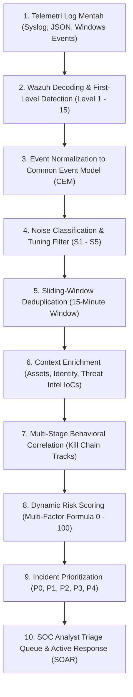
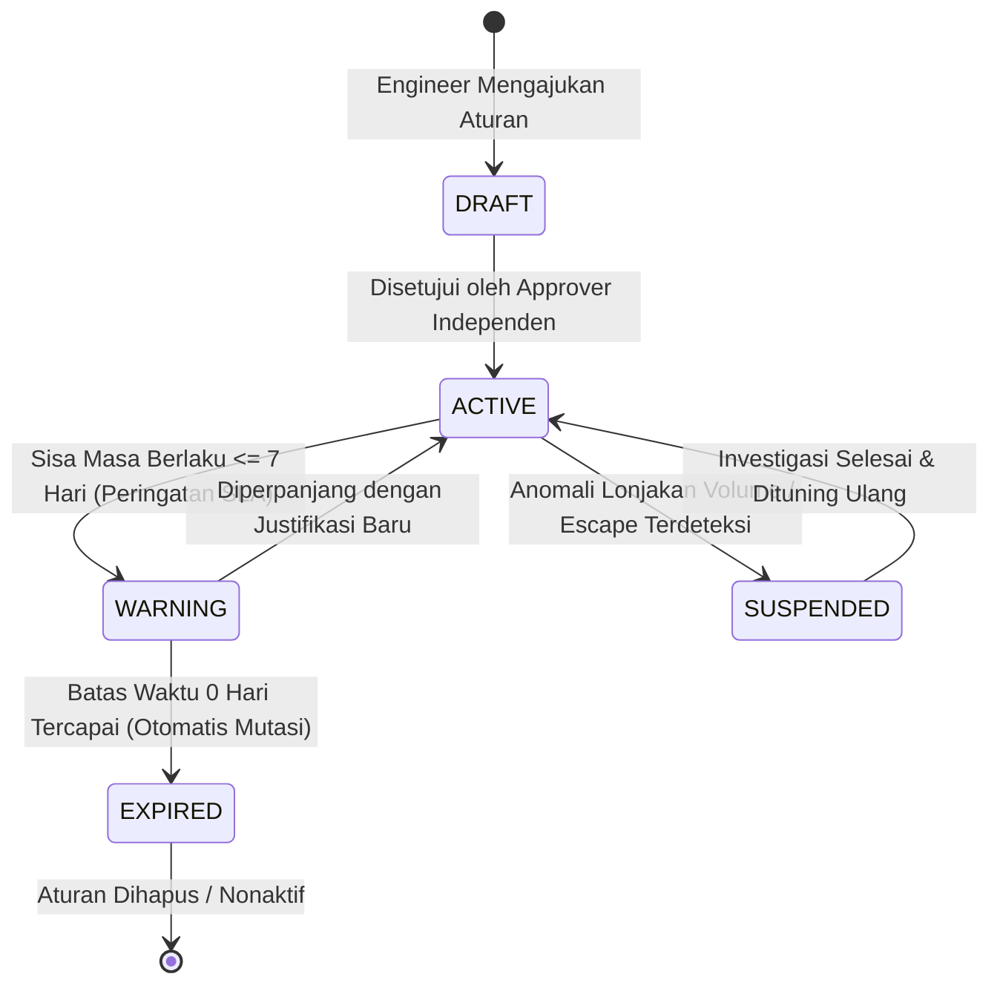

# DOKUMEN TATA KELOLA & MODEL KONTROL SISTEM (PHASE 0)
## *Enterprise Alert Tuning Governance, Ownership Matrix & Suppression Lifecycle Model*

---

### 1. RINGKASAN EKSEKUTIF & PRINSIP TATA KELOLA
Dalam operasional *Security Operations Center* (SOC) skala enterprise, masalah terbesar bukanlah ketiadaan data, melainkan **Alert Fatigue** akibat banjir peringatan berulang (*repetitive noise*). Namun, pemotongan kebisingan tidak boleh dilakukan secara serampangan (*ad-hoc*) yang dapat memicu celah keamanan (*blind spots*).

Dokumen ini mendefinisikan **Model Kontrol dan Tata Kelola (Phase 0)** yang mengatur kepemilikan, wewenang, alur persetujuan, dan siklus hidup setiap aturan deteksi dan supresi dalam sistem **Wazuh Enterprise Multi-Stage Alert Pipeline**.

> [!IMPORTANT]
> **HUKUM UTAMA TATA KELOLA SUPRESI:**
> 1. **Zero Anonymous Tuning:** Tidak ada supresi log atau agregasi yang boleh dibuat tanpa *Owner* dan *Approver* yang sah.
> 2. **Time-Bound Exception:** Setiap aturan supresi **WAJIB** memiliki tanggal kedaluwarsa (*expiration date*). Tidak ada supresi permanen tanpa batas waktu.
> 3. **Separation of Duties (SoD):** Pembuat aturan supresi (*Author*) **TIDAK BOLEH** menyetujui aturannya sendiri (*Approver* $\neq$ *Author*).
> 4. **Suppress Events, Preserve Evidence:** Supresi hanya meredam notifikasi kebisingan ke layar analis, tetapi **100% data log mentah tetap wajib disimpan utuh di database partisi** untuk keperluan bukti hukum dan investigasi forensik.

---

### 2. ARSITEKTUR ALIRAN PIPELINE LOGIKA (LOGICAL PIPELINE FLOW)

Sistem memisahkan tanggung jawab antara mesin deteksi Wazuh di layer hulu (*upstream*) dengan mesin korelasi cerdas di layer hilir (*downstream*):



#### Pemisahan Tanggung Jawab (Separation of Concerns):
| Layer Sistem | Komponen | Tanggung Jawab Operasional |
| :--- | :--- | :--- |
| **Upstream Layer** | **Wazuh Manager (XML Ruleset)** | Log collection, regex decoding, deteksi anomali dasar, agregasi frekuensi sederhana (`frequency`/`timeframe`), dan klasifikasi grup event. |
| **Downstream Layer** | **Python Pipeline Engine & PostgreSQL** | Normalisasi skema CEM, deduplikasi dinamis berbasis hash komposit, pengayaan konteks aset kritis, korelasi multi-tahap lintas host (*cross-host*), kalkulasi skor risiko dinamis, dan manajemen tiket triage SOC. |

---

### 3. TUNING OWNERSHIP & APPROVAL MATRIX

Setiap komponen deteksi dan supresi memiliki pemegang tanggung jawab (*Owner*) dan pihak berwenang yang menyetujui (*Approval Authority*):

| Komponen Tuning | Penanggung Jawab (*Owner*) | Pihak Penyetuju (*Approval Required*) | Siklus Review Wajib | Dampak Kepatuhan GRC |
| :--- | :--- | :--- | :---: | :--- |
| **Wazuh Detection Rule** | Detection Engineering | Security Lead / SOC Lead | Quarterly | Perubahan logika deteksi signature Wazuh. |
| **Suppression Rule (S1, S2, S3)** | Detection Engineering | SOC Lead | Monthly | Meredam kebisingan operasional rutin. |
| **Critical Suppression (S4, S5)** | Detection Engineering | Security Manager | Weekly / Event-based | Meredam alert pada server *Crown Jewels*. |
| **Allowlist / CDB List** | Asset / Application Owner | Security Lead | Monthly | Pembaruan daftar scanner dan subnet resmi. |
| **Correlation Rule (Attack Chain)** | Detection Engineering | SOC Lead | Quarterly | Skenario rantai serangan multi-event. |
| **Risk Scoring Weights** | SOC + Security Engineering | Security Manager | Quarterly | Perubahan bobot faktor risiko dinamis. |
| **Expired Exception** | Rule Owner (*Author*) | Security Manager | Automatic SLA | Evaluasi perpanjangan exception yang habis tempo. |

---

### 4. TAKSONOMI 5 KELAS SUPRESI (S1 — S5)

```text
┌──────────────────────────────────────────────────────────────────────────────────┐
│                           TAKSONOMI 5 KELAS SUPRESI                              │
├──────────────────────────────────────────────────────────────────────────────────┤
│ [S1] KNOWN-GOOD ACTIVITY                                                         │
│      Aktivitas legal dan terverifikasi dari scanner kerentanan (Nessus, Qualys)  │
│      atau aplikasi terpercaya. Ditekan penuh (no_log / severity deduction).      │
├──────────────────────────────────────────────────────────────────────────────────┤
│ [S2] REPETITIVE DEDUPLICATION                                                    │
│      Event identik berulang dari sumber yang sama (Web 400 burst, scanner bot).  │
│      Dikompresi menjadi 1 objek ringkas per jendela waktu sliding-window.        │
├──────────────────────────────────────────────────────────────────────────────────┤
│ [S3] BEHAVIORAL AGGREGATION                                                      │
│      Event individual berkadar rendah yang hanya bernilai jika mencapai kuota    │
│      tertentu (Contoh: > 8 failed login dalam 2 menit).                          │
├──────────────────────────────────────────────────────────────────────────────────┤
│ [S4] MAINTENANCE WINDOWS                                                         │
│      Aktivitas deployment, patching OS, atau uji coba terjadwal resmi.           │
│      Diberi pengurangan skor otomatis (-25 poin) selama periode jendela aktif.  │
├──────────────────────────────────────────────────────────────────────────────────┤
│ [S5] CONDITIONAL MITIGATION                                                      │
│      Event mencurigakan tetapi host target memiliki kontrol kompensasi aktif     │
│      (Contoh: Exploit Apache ditolak oleh Web Application Firewall / WAF).       │
└──────────────────────────────────────────────────────────────────────────────────┘
```

---

### 5. ATRIBUT WAJIB ATURAN SUPRESI & ENFORCEMENT POSTGRESQL

Setiap aturan supresi yang didaftarkan ke sistem **WAJIB** memuat 10 atribut metadata berikut:

1. `suppression_id`: Pengenal unik aturan (Format: `SUP-YYYY-XXXX`).
2. `rule_name`: Nama deskriptif tujuan supresi.
3. `suppression_class`: Kategori taksonomi (`S1_KNOWN_GOOD`, `S2_DEDUPLICATION`, dll.).
4. `author`: Identitas engineer pembuat (*Owner*).
5. `approver`: Identitas pejabat yang menyetujui (*Risk Accepted By*).
6. `ticket_id`: Nomor tiket Change Management resmi (Contoh: `CRQ-2026-9001`).
7. `business_reason`: Justifikasi bisnis tertulis mengapa alert perlu diredam.
8. `created_date`: Tanggal pendaftaran aturan.
9. `expires_date`: Tanggal mutlak kedaluwarsa aturan (Maksimal 90 hari untuk ad-hoc exception, atau maksimal 180 hari / 6 bulan untuk aktivitas rutin resmi terverifikasi S1/S2 dengan siklus review berkala).
10. `review_cycle`: Frekuensi audit wajib (`WEEKLY`, `MONTHLY`, `QUARTERLY`).

#### Penegakan Invariant Database (Check Invariant):
Di level database PostgreSQL (`database/migrations/001_initial_schema.sql`), integritas ini dikunci secara absolut:
```sql
CONSTRAINT chk_separation_of_duties CHECK (author <> approver),
CONSTRAINT chk_suppression_expires_future CHECK (expires_date >= created_date)
```

---

### 6. SIKLUS HIDUP & AUDIT KEDALUWARSA SUPRESI (SLA LIFECYCLE)



1. **Peringatan Dini ($\le 7$ Hari):** Mesin `pipeline/governance.py` memunculkan notifikasi kuning di SOC Dashboard kepada Rule Owner untuk melakukan perpanjangan.
2. **Kedaluwarsa Otomatis ($0$ Hari):** Status aturan otomatis bermutasi menjadi `EXPIRED`. Mesin secara instan menghentikan supresi sehingga seluruh alert kembali diteruskan ke analis (mencegah penyerang bersembunyi di balik supresi usang).
3. **Pemeriksaan Deviasi Baseline ($\sigma \ge 3.00$):** Jika volume event yang diredam melonjak drastis melebihi $3$ standar deviasi dari rata-rata harian, sistem memicu investigasi *Suppression Escape* untuk mendeteksi apakah penyerang memanipulasi alamat IP scanner resmi.
