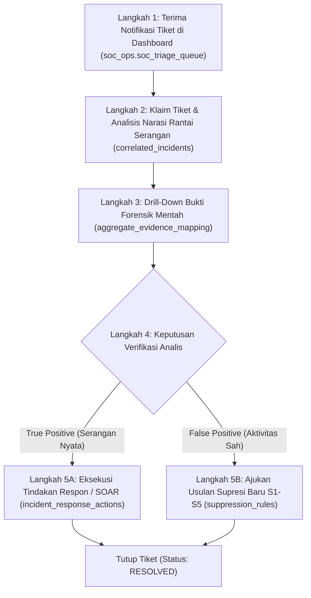

# STANDAR OPERASIONAL PROSEDUR (SOP) ANALIS SOC
## *Incident Triage, Forensic Investigation & Suppression Governance SOP*

---

### 1. TUJUAN & RUANG LINGKUP
Dokumen SOP ini mengatur prosedur standar operasional bagi seluruh personil Security Operations Center (Tier 1 Triage Analyst, Tier 2 Incident Responder, dan Tier 3 Threat Hunter / SOC Lead) dalam menangani antrean insiden dari platform **Wazuh Alert Grouping & Triage Pipeline**.

---

### 2. MATRIKS RESPON TRIAGE BERDASARKAN PRIORITAS (P0 — P4)

Setiap tiket insiden yang masuk ke antrean `soc_ops.soc_triage_queue` memiliki Service Level Agreement (SLA) dan alur eskalasi yang mengikat:

| Prioritas Tiket | Rentang Skor Risiko | Target SLA Triage | Target Role | Tindakan Mitigasi Utama |
| :--- | :---: | :---: | :--- | :--- |
| **🚨 P0 (CRITICAL)** | **81 – 100** | **< 15 Menit** | Tier 2 + SOC Lead | Isolasi host segera via SOAR, eskalasi ke Incident Commander, pembekuan sesi privilege. |
| **🟠 P1 (HIGH)** | **61 – 80** | **< 30 Menit** | Tier 1 / Tier 2 | Verifikasi brute force & pembobolan akun, pemblokiran IP penyerang di perimeter firewall. |
| **🟡 P2 (MEDIUM)** | **41 – 60** | **< 4 Jam** | Tier 1 Analyst | Validasi anomali proses eksekusi atau lonjakan scanner internal tak dikenal (Review Shift). |
| **🔵 P3 (LOW)** | **21 – 40** | **< 24 Jam** | Tier 1 Analyst | Review aktivitas scan acak eksternal / event terisolasi (Review Harian). |
| **⚪ P4 (INFORMATIONAL)** | **0 – 20** | **< 7 Hari** | Tier 1 Analyst / Threat Hunter | Analisis log berkala, audit telemetri mingguan & deteksi tren anomali (Review Mingguan). Bukan auto-suppress. |

---

### 3. ALUR KERJA TRIAGE INSIDEN 5-LANGKAH (STEP-BY-STEP)

#### Langkah 1: Menerima Tiket
1. Buka antarmuka SOC Dashboard pada tab **Incident Triage Queue**.
2. Filter berdasarkan prioritas tertinggi (`P0` dan `P1`).
3. Klik tombol **`[Claim Ticket]`** untuk menetapkan diri Anda sebagai `assigned_analyst`.

#### Langkah 2: Evaluasi Narasi & Urutan Serangan
1. Periksa rincian insiden: Host target, akun korban, IP penyerang, dan skor risiko.
2. Analisis kronologi tahapan pada panel **Attack Chain Stages** (Contoh: Stage 1 = Failed Login $\ge 5 
ightarrow$ Stage 2 = Success Login).

#### Langkah 3: Drill-Down Bukti Forensik Mentah
1. Klik tombol **`[View Forensic Evidence]`** untuk melihat seluruh baris log mentah yang terpetakan ke objek insiden tersebut.
2. Periksa parameter kritis: *User-Agent*, *Source Port*, *Execution Path*, dan *Command-Line Arguments*.

#### Langkah 4 & 5: Keputusan Respon
* **Jika True Positive:**
  1. Klik tombol **`[True Positive]`**.
  2. Pilih aksi respon aktif:
     * `BLOCK_IP_FIREWALL`: Menembakkan perintah blokir IP penyerang.
     * `RESET_USER_PASSWORD`: Memutus sesi aktif dan mengunci akun.
     * `ISOLATE_HOST`: Memutus koneksi jaringan host terinfeksi.
  3. Berikan catatan investigasi pada form `incident_investigation_notes`.
* **Jika False Positive:**
  1. Klik tombol **`[False Positive]`**.
  2. Sistem otomatis membuka form usulan supresi baru.
  3. Masukkan justifikasi bisnis dan pilih kelas supresi (`S1`, `S2`, `S3`, atau `S4`).

---

### 4. ALUR PENGAJUAN EXCEPTION SUPRESI (SEPARATION OF DUTIES)

Untuk mencegah seorang analis meredam ancaman nyata secara sepihak, setiap pengajuan supresi wajib mengikuti protokol **Separation of Duties**:

1. **Pengusul (*Author*):** Analis SOC atau Detection Engineer mengisi form supresi:
   * Rule ID target
   * Alasan bisnis (*Business Reason*)
   * Nomor tiket CRQ resmi
   * Tanggal kedaluwarsa (Maksimal 90 hari untuk exception ad-hoc, atau maksimal 180 hari / 6 bulan untuk aktivitas rutin resmi terverifikasi seperti scanner/deduplikasi dengan review berkala)
2. **Penyetuju (*Approver*):** Tiket masuk ke antrean persetujuan **SOC Lead** atau **Security Manager**.
   * Penyetuju memverifikasi apakah supresi tidak mengenai aset *Crown Jewels*.
   * Penyetuju menekan tombol **`[Approve]`** atau **`[Reject]`**.
3. **Pemberlakuan:** Sistem PostgreSQL memvalidasi constraint `author <> approver` dan mengaktifkan aturan di `suppression_rules`.
