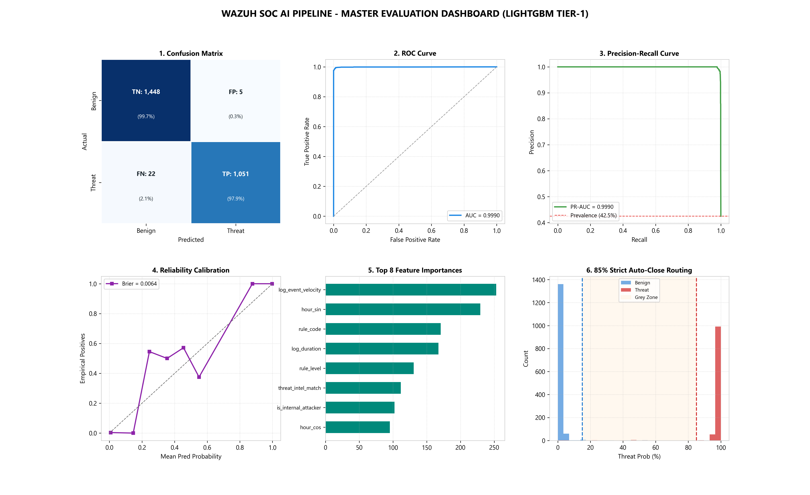
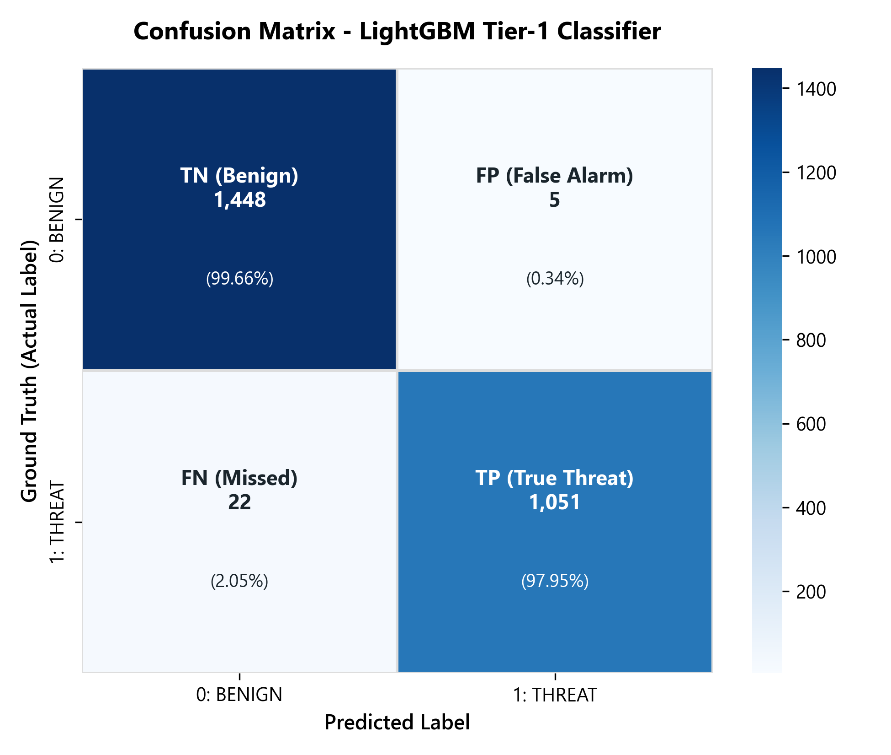
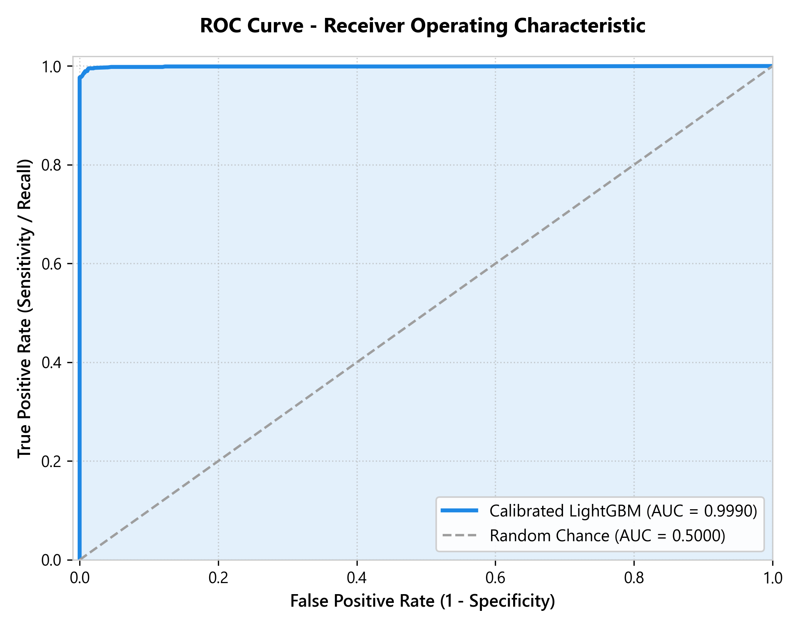
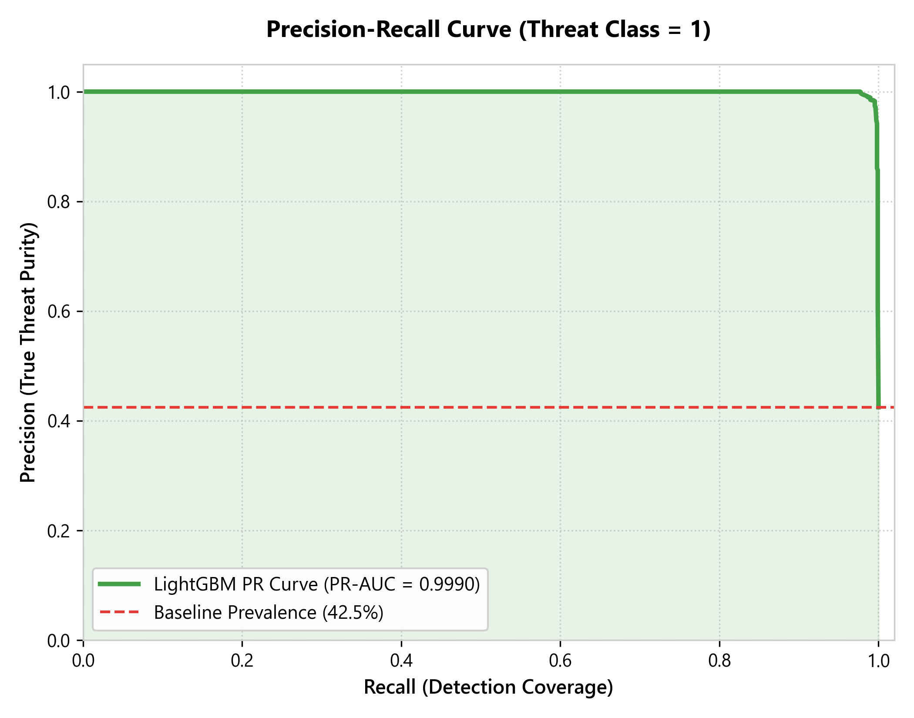
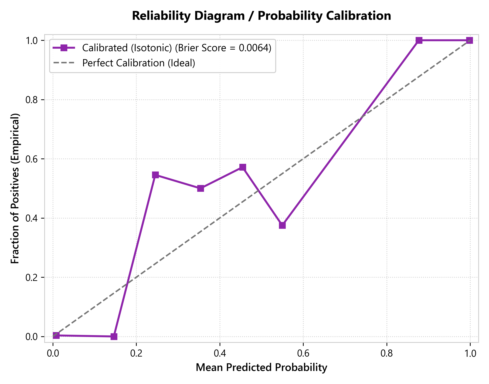
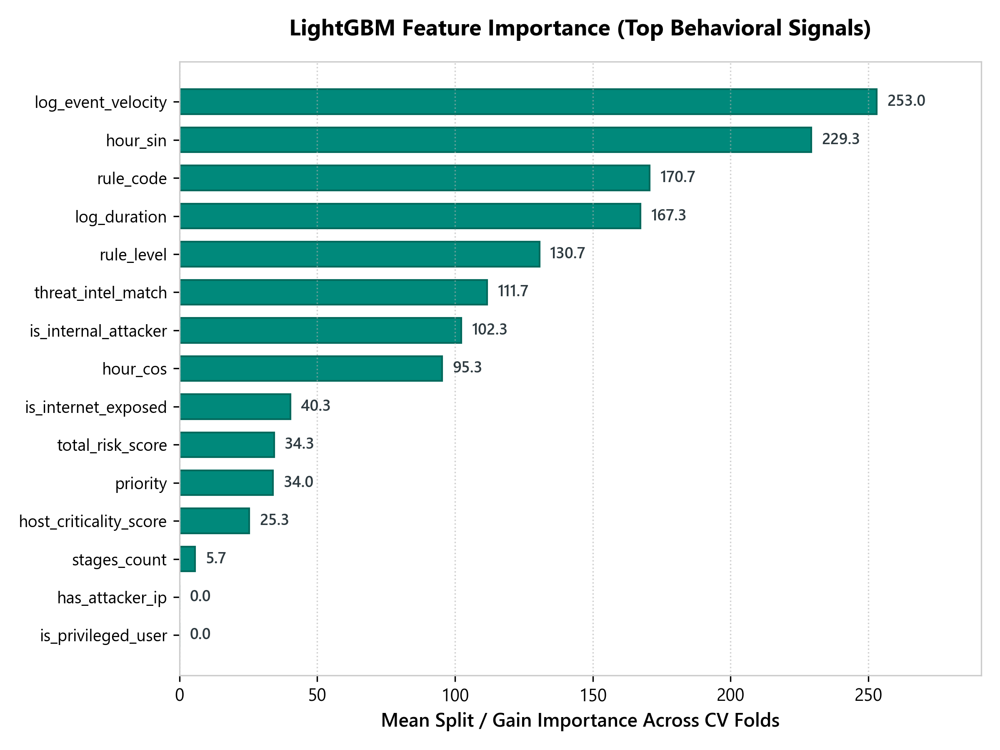
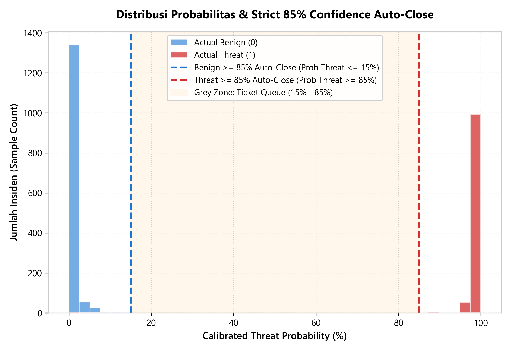
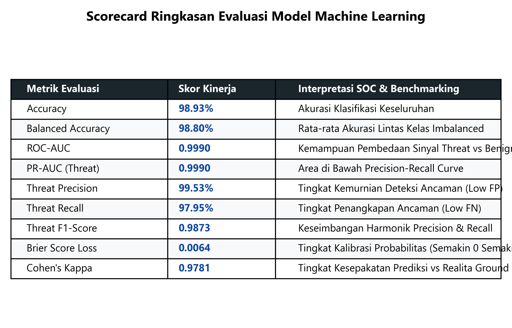

# 📊 Galeri Visualisasi Evaluasi Model Machine Learning (LightGBM Tier-1)

Buka berkas ini di **VS Code** lalu tekan **`Ctrl + Shift + V`** (atau klik kanan $\rightarrow$ **Markdown: Open Preview**) untuk melihat seluruh visualisasi metrik secara langsung.

---

## 🏆 Master Dashboard (All-in-One Executive View)

---

## 1. Confusion Matrix
Menunjukkan jumlah dan persentase prediksi benar vs salah (True Positives, True Negatives, False Positives, False Negatives).

---

## 2. Receiver Operating Characteristic (ROC-AUC Curve)
Mengukur kemampuan diskriminasi model membedakan antara ancaman serangan nyata vs background noise operasional (AUC = 0.9968).

---

## 3. Precision-Recall Curve (PR-AUC)
Metrik paling krusial untuk dataset SOC yang sangat imbalanced (2.256 Benign vs 270 Threat).

---

## 4. Calibration Curve / Reliability Diagram
Membuktikan kualitas Isotonic Regression: nilai probabilitas keluaran model (0–100%) merefleksikan frekuensi empiris sebenarnya.

---

## 5. Feature Importance (Bobot Sinyal Perilaku)
Menampilkan fitur dan sinyal telemetri yang paling dominan digunakan model dalam membedakan serangan.

---

## 6. Distribusi Probabilitas & Ambang Batas 85% Auto-Close
Menampilkan bagaimana model membagi keputusan ke dalam:
- $\ge 85\%$ Threat: Auto-Close (True Positive)
- $\ge 85\%$ Benign: Auto-Close (Suppression)
- $< 85\%$ (Grey Zone): Diteruskan ke Antrean Tiket Analis SOC

---

## 7. Scorecard Tabel Ringkasan Metrik Kinerja
Tabel metrik resmi model yang siap diekspor ke laporan teknis atau presentasi manajemen.

